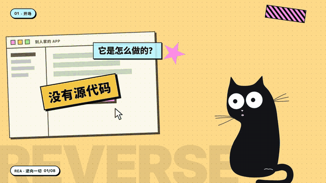
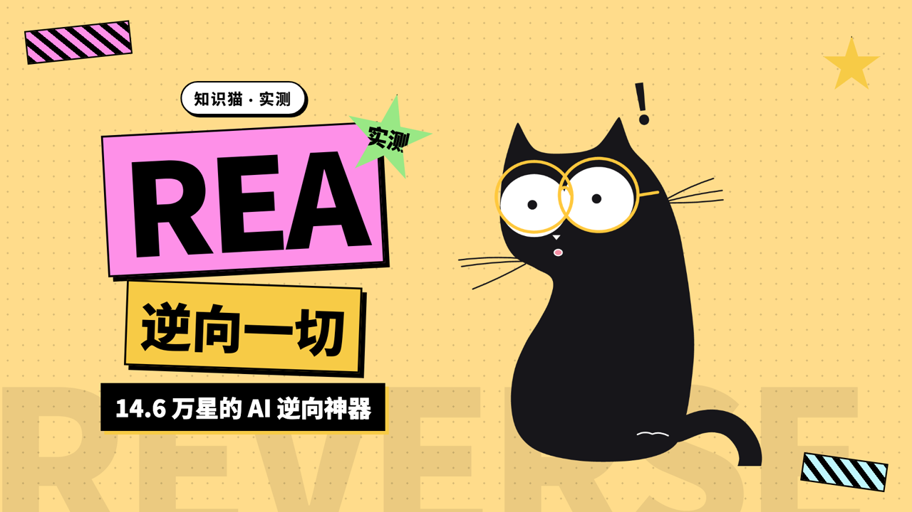

# 知识猫 GeekCat


斜眼小黑猫「墨墨」：一个**完全由代码绘制**的 SVG 角色，专门给视频当陪伴角色——讲解、举牌、吐槽、角落探头。写一份剧本 JSON，一条命令渲染成透明背景视频，或者直接合成进你的主视频。为 AI agent 设计：Codex、Claude Code、Gemini CLI 都可以照着 [AGENTS.md](AGENTS.md) 直接操作。

*A code-drawn cat character for video overlays. Write a JSON script, get a transparent ProRes / WebM clip or a finished composite. Built for AI agents — see [AGENTS.md](AGENTS.md).*

- **17 个动作**：待机、说话、好奇、思考（灯泡）、吓一跳、炸毛、开心、欢呼、挥手、点头、摇头、眨眼、跳跃、睡觉、登场、退场……
- **13 个场景**：举牌（字可改）、对话气泡、教鞭指示、敲电脑、看书、逗小鱼、角落探头，以及 6 个大姿势：写字、趴卷轴、游泳圈、文件柜探头、钱堆打滚、被蜘蛛吓到
- **7 件配饰**：圆眼镜、学士帽、耳机、领结、铃铛项圈、叼小鱼、腮红——跟着身体一起动，还会被吓得弹起来
- **丝滑**：所有动作只插值参数、不插值路径；切换从屏幕上的合成帧出发；尾巴逐节延迟形成波动。测试会锁住"任意切换每帧位移有上限"
- **可复现**：每一帧是时间的纯函数，任何机器渲染结果逐像素一致；字体随仓库附带，不依赖系统
- **口型同步**：给一段配音，嘴巴按音量自动开合

## 实战：知识猫主讲的 4 分钟讲解视频



用仓库里的 [`ip-explainer-video`](skills/ip-explainer-video) skill 做的一期《REA：逆向一切》：豆包语音 2.0 旁白、HyperFrames 逐场景搭画面（BlockFrame 设计）、真实终端演示（用 REA 逆向知识猫自己的代码），知识猫作为原生图层全程主讲，嘴型跟着旁白走。1080p60，4 分 02 秒。



## 快速开始

```bash
git clone https://github.com/gnipbao/geekcat-bot.git && cd geekcat-bot
npm install                       # Node 18+，自动带上 ffmpeg（ffmpeg-static）
npm test

# 1) 渲染一段透明叠加层
node render/render.mjs render render/examples/corner.json -o out/corner.mov

# 2) 按字幕给你的视频加上墨墨，一条命令出成片
node render/render.mjs auto --video main.mp4 --srt subs.srt --corner -o out/final.mp4
```

在浏览器里玩：`npm run preview`，打开 `prototype/index.html`（方案文档 + 可交互舞台）。

## 剧本长什么样

```json
{
  "cat": { "x": 0.85, "y": 0.97, "scale": 0.6 },
  "accessories": ["glasses"],
  "timeline": [
    { "at": 0,   "do": "enter" },
    { "at": 1.0, "do": "talk", "scene": "sign", "text": "今天讲 3 件事" },
    { "at": 4.2, "do": "curious", "scene": "bubble", "text": "为什么？" },
    { "at": 6.0, "do": "idle", "scene": "write" },
    { "at": 9.0, "do": "exit" }
  ]
}
```

字段说明、编排指南、完整的 agent 工作流见 [AGENTS.md](AGENTS.md)；JSON Schema 在 [render/script.schema.json](render/script.schema.json)。

## 命令一览

| 命令 | 作用 |
|---|---|
| `list` / `schema` | 动作、场景、配饰目录；剧本 JSON Schema |
| `draft subs.srt` | 按字幕自动编排剧本草稿 |
| `validate` / `still` | 校验剧本；渲染关键帧 PNG 检查构图 |
| `render -o x.mov` | 透明视频（.mov ProRes 4444 / .webm VP9 / .mp4 绿幕 / .gif / PNG 序列） |
| `composite` | 把透明叠加层合成到主视频上 |
| `auto` | 字幕 → 剧本 → 渲染 → 合成，一条命令 |
| `hyperframes` | 生成 HyperFrames 子合成，知识猫作为原生图层挂进视频工程（[实战](#实战知识猫主讲的-4-分钟讲解视频)） |
| `live` | 直播 / OBS 浏览器源，HTTP 遥控 + 快捷键 |

## Skill：让 IP 角色主讲一期讲解视频

[`skills/ip-explainer-video`](skills/ip-explainer-video/SKILL.md) 把上面那期视频的做法沉淀成可复用的流程：调研 → 口播稿 → 豆包 2.0 **整段**配音（更像真人，支持克隆声音）→ HyperFrames 场景 → IP 角色图层 → 渲染 → 五比例封面。**主题、IP 角色、声音都可替换**：换角色只需要一份 `ip.json`（[接入约定](skills/ip-explainer-video/references/ip-contract.md)），默认是知识猫。

安装（任选其一）：

```bash
npx skills add gnipbao/geekcat-bot --skill ip-explainer-video      # skills CLI
ln -s "$PWD/skills/ip-explainer-video" ~/.claude/skills/            # Claude Code
ln -s "$PWD/skills/ip-explainer-video" ~/.agents/skills/            # Codex 等读取 ~/.agents/skills 的 agent
```

依赖 [HyperFrames](https://www.hyperframes.dev)（`npx hyperframes doctor`）、ffmpeg、Python 3，以及环境变量 `DOUBAO_TTS_TOKEN`。skill 不在本仓库目录下使用时，设置 `GEEKCAT_REPO=/path/to/geekcat-bot`。然后对 agent 说："让知识猫做一期 XX 的介绍视频"。

## 在剪辑软件里用

- **Premiere / Final Cut / 达芬奇 / 剪映专业版**：把 `.mov` 拖到主视频上方轨道。
- **剪映 / CapCut 手机版**：渲染 `.mp4`（自动绿幕），画中画导入后色度抠图。
- **After Effects**：渲染到目录，得到透明 PNG 序列。
- **OBS 直播**：`node render/render.mjs live`，添加浏览器源。

## 原理

架构参考了 [bloub](https://github.com/jeremy-prt/bloub)（复刻 Grok 头像的 SVG 动画）：引擎没有时钟，`frameAt(schedule, t)` 只依赖时间。不同的是猫的轮廓不是圆，所以没有用径向半径，而是：

- 身体是 32 个锚点 + 头部权重 + 弦长切线贝塞尔；趴、弓身等大姿势是同一组锚点的另一套坐标，所以坐姿和趴姿之间是连续变形。
- 眼睛是"椭圆 ∩ 上下眼睑"，一个参数就能在睡眼、笑眼、竖缝瞳孔之间连续变化；用 clipPath 实体而不是 mask 镂空，导出透明视频时眼睛不会透底。
- 尾巴是 8 节正向运动学，第 i 节读取 i×45ms 前的姿态；惯性由相邻两次纯采样的速度驱动——不需要物理模拟，所以可以随意跳到任一时刻。
- 配饰画在猫自己的坐标系里，外面套上映射在该点的雅可比矩阵，所以歪头、挤压、打滚时贴合不错位。

## 造型校准

造型数字是从参考图测量的。参考图不随仓库分发；本地校准时把单只猫的高清图放到 `prototype/ref.png`，打开 `prototype/index.html` 点「叠加参考图」对照调整 `prototype/cat-engine.js` 里的 `BODY` / `EYES` 锚点，然后跑 `npm test`。

## 授权

代码 MIT；`render/fonts/` 里的 Noto Sans SC 为 SIL Open Font License 1.1。角色造型参考了 Canva 上的插画素材，若用于商业品牌，请先确认素材授权。
